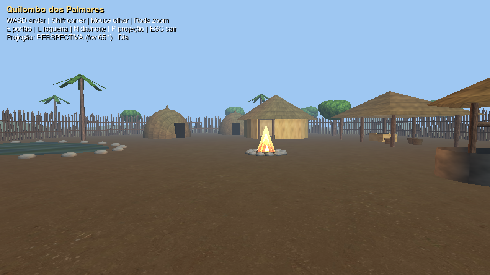
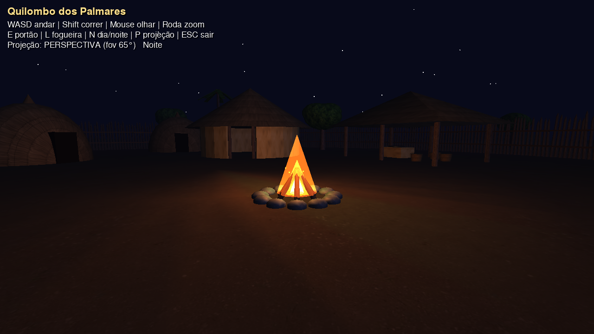

# Quilombo dos Palmares — Modelagem 3D Interativa com OpenGL (AB2)

Cena 3D em primeira pessoa do Quilombo dos Palmares (Serra da Barriga, União dos Palmares — AL),
feita em **Python + OpenGL puro** (pipeline fixo, GLU), sem engine nem framework de jogo.
Bibliotecas: **PyOpenGL** (OpenGL/GLU), **GLFW** (só abre a janela e lê teclado/mouse) e **Pillow** (só lê as imagens das texturas e desenha o texto da tela). Disciplina de Computação Gráfica — UFAL.

**Equipe:** Alan Diogo da Rocha Oliveira · Bruno Gomes de Barros Filho




## Como instalar e rodar

Requisitos: **Python 3.10+** (Windows, Linux ou macOS).

```bash
pip install -r requirements.txt
python main.py
```

No Windows, se `pip`/`python` não forem reconhecidos, use o lançador `py`:

```bash
py -m pip install -r requirements.txt
py main.py
```

Modo demonstração (a câmera anda e as interações acontecem sozinhas): `python main.py --demo`

No Linux pode ser preciso instalar a GLU: `sudo apt install libglu1-mesa`.

## O jogo: "Um dia no Quilombo"

Você chega do lado de fora da paliçada e precisa cumprir as tarefas do dia, mostradas no canto da tela:

1. Abrir o portão e entrar no quilombo (**E**)
2. Buscar água no poço (**F**)
3. Esperar anoitecer (**N**)
4. Acender a fogueira à noite (**L**)
5. Subir na atalaia (torre de vigia) e vigiar o quilombo (**E** ao pé da escada)

Ao completar tudo aparece "Missão cumprida" com o tempo gasto.

## Comandos

| Tecla / mouse | Ação |
|---|---|
| **W A S D** | Andar |
| **Mouse** | Olhar (azimute e elevação) |
| **Shift** | Correr |
| **Roda do mouse** | Zoom (ângulo de visão na perspectiva / tamanho na ortográfica) |
| **E** (perto do portão) | Abrir / fechar o portão |
| **E** (ao pé da escada da atalaia) | Subir / descer da torre de vigia |
| **F** (perto do poço) | Descer o balde (ele enche na água e sobe sozinho); com o balde cheio, **F** despeja |
| **L** (perto da fogueira) | Acender / apagar a fogueira (liga a luz pontual) |
| **N** | Dia / noite |
| **P** | Projeção perspectiva ↔ ortográfica (vista de mapa) |
| **ESC** | Sair |

## Objetos modelados (todos pela equipe, com primitivas — nenhum modelo importado)

1. Chão (grama + praça de terra) e morros ao longe
2. Paliçada (muro de ~550 varas em círculo + travessas)
3. Portão duplo (folhas com pivô na dobradiça)
4. Muxima (casa redonda: parede de reboco em anel + teto cônico de palha)
5. Oca (esfera de palha esticada com escala)
6. Casa de farinha (postes + telhado de 4 águas + forno e tacho)
7. Árvore (tronco + copa de esferas achatadas)
8. Coqueiro (tronco + folhas giradas em volta do topo)
9. Poço (mureta de pedra com borda, sarilho com manivela que gira, balde com aros e alça, corda que estica, ondas na água e gotas caindo)
10. Fogueira (pedras + lenha + chama animada e faíscas)
11. Lagoa (elipse com água transparente e animada)
12. Atalaia (torre de vigia com escada inclinada, plataforma, parapeito e telhado)

## Estrutura

```
main.py         câmera, iluminação, interações e laço principal
objetos.py      modelagem de cada objeto (primitivas + transformações)
primitivas.py   cilindro, esfera, disco, caixa, texturas e materiais
texturas/       imagens das texturas
```
